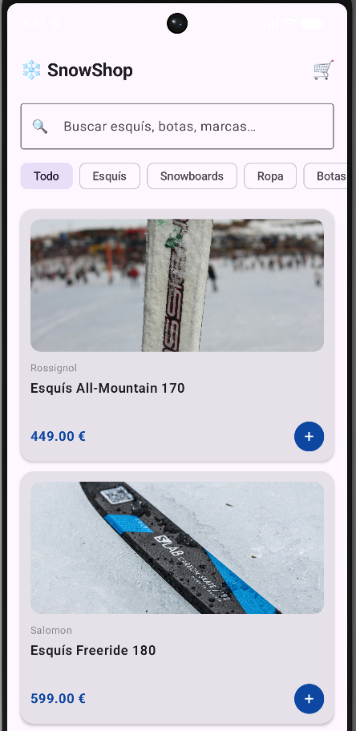
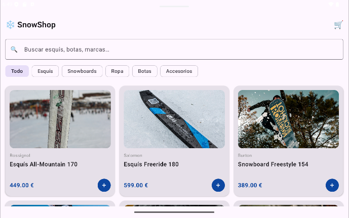

# Reto 2 · E-Commerce Adaptativo (Responsive UI)

**Módulo:** 0489 · Programación Multimedia y Dispositivos Móviles
**Autor:** Lucas Hernandez Romero
**Tecnología:** Kotlin + Jetpack Compose (Android nativo)
**RA vinculado:** RA1 y RA2 · Interfaces adaptables y limitaciones del dispositivo

---

## 📱 Producto Final (Capturas)

| Móvil (vertical) | Tablet / móvil (horizontal) |
|---|---|
|  |  |

En el móvil (Pixel 6, vertical) la cuadrícula muestra **1 columna** y en la tablet (Small Tablet, horizontal) muestra **3 columnas**, con el mismo código y las mismas tarjetas. Se consigue con `GridCells.Adaptive(minSize = 280.dp)`.

---

## 🎯 Objetivo del reto

Comprender la fragmentación de pantallas en Android y resolver los problemas de visualización en distintos perfiles de dispositivos. Pasar de un diseño estático (una lista infinita que se deforma) a una interfaz responsive (una cuadrícula inteligente) utilizando componentes de Jetpack Compose que calculan el espacio disponible en tiempo real.

## 🛠️ Componentes y conceptos utilizados

| Componente / Concepto | Para qué se usa en esta app |
|---|---|
| `LazyVerticalGrid` | Sustituye a `LazyColumn` para crear una cuadrícula en lugar de una lista simple. |
| `GridCells.Adaptive` | Calcula automáticamente cuántas columnas caben en la pantalla indicando solo el tamaño mínimo por tarjeta. |
| `Card` | Crea un contenedor elevado y con bordes redondeados para agrupar la imagen y los datos de cada producto. |
| `ContentScale.Crop` | Asegura que la imagen llene el espacio asignado recortando los bordes en lugar de deformarse al rotar la pantalla. |
| `maxLines` & `TextOverflow` | Fuerza a que los textos largos tengan un máximo de líneas y añade puntos suspensivos (...) para no descuadrar las tarjetas. |
| Mock Data (Datos) | Uso de una `data class` y una lista local para simular la información antes de conectar una base de datos real. |

## 🧐 Reflexión y Pensamiento Crítico

**1. Sobre la adaptabilidad: ¿Por qué hemos usado `GridCells.Adaptive(minSize = ...)` en lugar de fijar el número de columnas con `GridCells.Fixed(2)`? ¿Qué ventaja tiene en el mundo real?**

Con `Fixed(2)` siempre habría 2 columnas, da igual el dispositivo. En una tablet las tarjetas se verían enormes y estiradas, y habría mucho espacio desaprovechado. Con `Adaptive` solo le digo el tamaño mínimo de cada tarjeta y Compose calcula cuántas columnas caben según el ancho disponible. En el mundo real hay muchísimos tamaños de pantalla (móviles pequeños, tablets, plegables, pantalla dividida, rotación), y así con el mismo código la tienda se ve bien en todos sin tener que hacer un diseño distinto para cada uno.

**2. Sobre el diseño UI: ¿Qué ocurría con las tarjetas si el nombre de un producto era muy largo y ocupaba dos líneas mientras los demás ocupaban una? ¿Cómo lo hemos solucionado?**

Las tarjetas tenían alturas distintas y la cuadrícula quedaba descuadrada, con las filas desalineadas. Lo solucionamos limitando el texto del nombre con `maxLines = 2` y reservando siempre ese espacio con `minLines = 2`, de forma que todas las tarjetas miden lo mismo. Si el nombre es más largo de lo que cabe, se corta con puntos suspensivos gracias a `TextOverflow.Ellipsis`.

**3. Sobre las imágenes: ¿Por qué es importante usar `ContentScale.Crop` en la imagen del producto cuando cambiamos el ancho de la tarjeta al rotar la pantalla?**

Porque al rotar o cambiar de dispositivo el ancho de la tarjeta cambia, pero el recuadro de la imagen mantiene su altura. Con `Crop` la imagen se escala hasta llenar todo el recuadro y recorta lo que sobra por los bordes, sin estirarse. Si no lo usara, la imagen se deformaría o quedarían huecos vacíos alrededor, y las fotos (unas verticales y otras horizontales) se verían mal.

**4. Visión de futuro: Ahora mismo nuestros productos están escritos directamente en el código (hardcodeados). ¿Qué crees que necesitaría nuestra app en el futuro para que esta tienda mostrara productos reales de internet?**

Necesitaría conectarse a un servidor o API (por ejemplo una API REST que devuelva los productos en JSON) usando una librería como Retrofit, junto con el permiso de `INTERNET` en el `AndroidManifest`. Las imágenes ya no estarían en `res/drawable`, sino que se cargarían desde una URL con una librería como Coil. También haría falta gestionar los estados de carga y error (spinner mientras llegan los datos, mensaje si falla la conexión), separar la lógica en un `ViewModel` con corrutinas, y quizás una base de datos local como Room para guardar los productos y que funcione sin conexión.

## 🚀 Cómo ejecutar el proyecto

1. Clonar el repositorio y abrir en Android Studio.
2. Ejecutar (▶) primero en un emulador de móvil (ej. Pixel 6).
3. Girar la pantalla del móvil a horizontal o ejecutar en un emulador de Tablet para comprobar la adaptación de la cuadrícula.

## 🐞 Dificultades y cómo las resolví

Al cambiar los emojis por imágenes me salían 26 errores en rojo (`Unresolved reference 'drawable'`). El problema era que la primera línea del `MainActivity.kt` tenía un `package` distinto al del proyecto (`com.example.icomerce` en vez de `com.example.ski`), y por eso Android Studio no encontraba la clase `R` con mis imágenes. Lo arreglé poniendo el mismo `package` que el `namespace` del `build.gradle.kts` y haciendo *Sync Project with Gradle Files* y *Rebuild Project*.

Otro detalle fue que las fotos originales pesaban varios MB y podían dar problemas de memoria, así que las reduje a un máximo de 1000 px antes de meterlas en `res/drawable`.